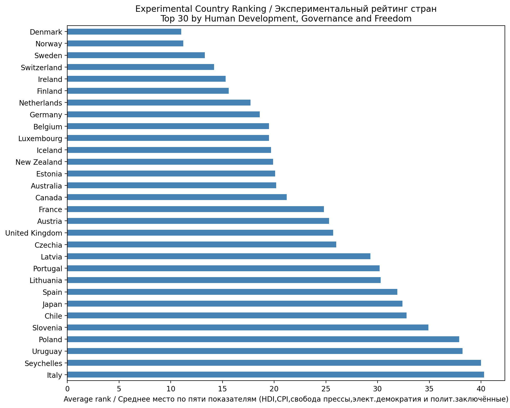
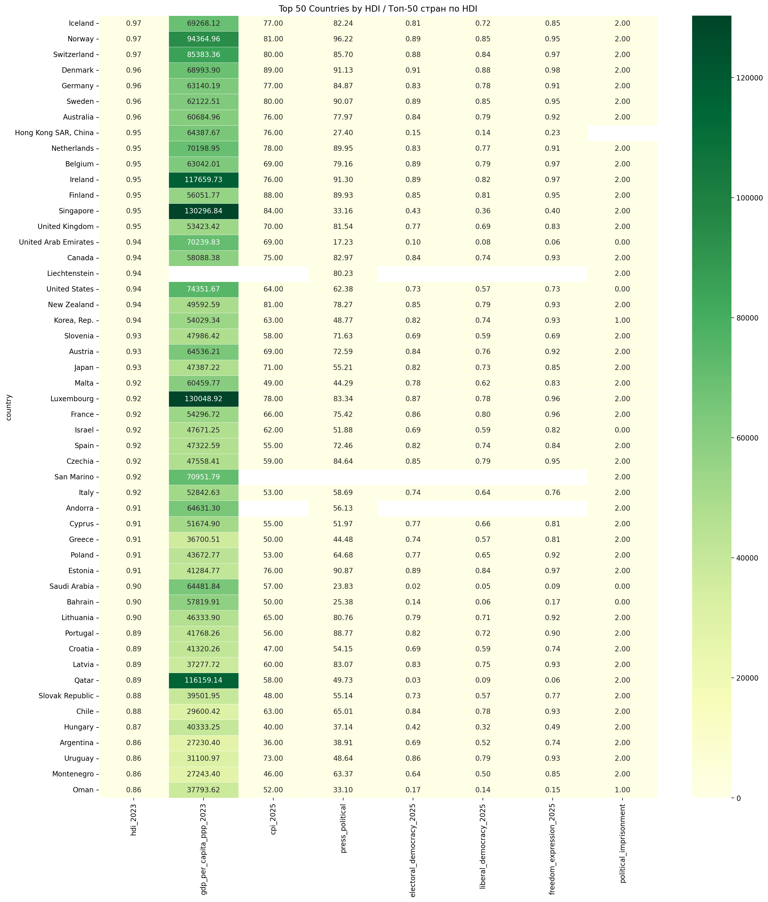
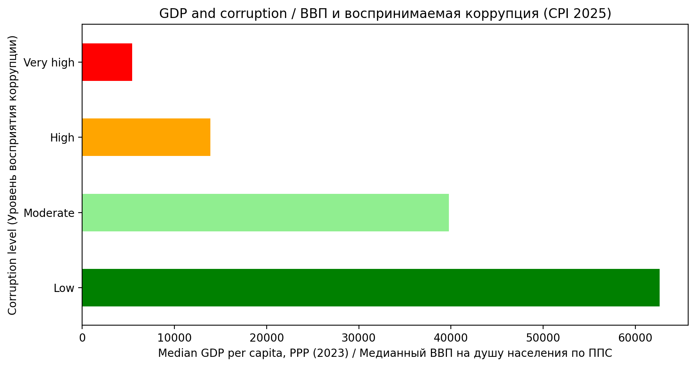

# World Development and Freedom

## Человеческое развитие, экономическое благосостояние, коррупция и политические свободы

## 1.	 Цель исследования — создание единой аналитической таблицы, позволяющей обнаружить взаимосвязи между следующими показателями:

-	Индекс человеческого развития (HDI).
-	Экономическое благосостояние, выраженное через ВВП на душу населения по паритету покупательной способности (ППС).
-	Индекс восприятия коррупции (CPI).
-	Уровень свободы прессы, свободы самовыражения и демократии.
-	Наличие политических заключённых.
Исследование направлено на выявление общих закономерностей и различий между странами с высоким и низким уровнем человеческого развития.

## 2. Источники данных — для исследования использованы открытые данные международных организаций:

-	World Bank (Всемирный банк) — население, площадь территории и ВВП на душу населения по ППС.
-	UNDP — индекс человеческого развития (HDI).
-	Transparency International — индекс восприятия коррупции (CPI).
-	V-Dem — показатели электоральной и либеральной демократии, свободы самовыражения.
-	Reporters Without Borders (RSF) — политический компонент индекса свободы прессы.
-	CIRIGHTS — показатель политического заключения.

## 3. Подготовка данных.

 Данные загружены из открытых источников, очищены и объединены в единую таблицу с использованием Python и библиотеки Pandas.
В процессе обработки выполнены преобразования типов данных, сопоставление стран по кодам, обработка отсутствующих значений и выбор показателей за соответствующие годы.
Итоговая таблица содержит 197 стран и отдельных территорий и 12 столбцов.
Строки, в которых отсутствовали все пять ключевых исследовательских показателей, исключены. Страны с частично отсутствующими данными сохранены для обеспечения более широкого географического охвата исследования.
## 4. Результаты.

В рамках исследования созданы три визуализации.

### 4.1. Экспериментальный рейтинг стран — топ-30

Горизонтальная столбчатая диаграмма отображает 30 стран с наиболее высокими позициями в экспериментальном сводном рейтинге.
Рейтинг рассчитан на основе среднего места страны по пяти показателям:
- Индекс человеческого развития (HDI).
- Индекс восприятия коррупции (CPI).
- Политическая свобода прессы.
- Электоральная демократия.
- Показатель политических заключённых.

Все пять показателей имеют равный вес. Чем меньше среднее место, тем выше позиция страны.
Рейтинг является экспериментальным и не представляет собой официальный международный индекс. В расчёт включены только страны с полными данными по пяти показателям.

### 4.2. Тепловая карта стран

Тепловая карта представляет сравнение стран, отсортированных по убыванию HDI.
Цветовая шкала от светло-зелёного до тёмно-зелёного позволяет визуально оценивать значения каждого показателя. Отсутствующие данные выделены серым цветом.
В таблице представлены HDI, ВВП на душу населения по ППС, CPI (уровень восприятия коррупции), свобода прессы, показатели демократии, свобода самовыражения и данные по политическим заключённым.

[Открыть тепловую карту — топ-50 стран](visualizations/heatmap_top50.html)

### 4.3. Взаимосвязь ВВП и воспринимаемой коррупции

Горизонтальная столбчатая диаграмма показывает медианный ВВП на душу населения по ППС в четырёх группах стран, сформированных по индексу CPI:
-	Very high — очень высокая воспринимаемая коррупция.
-	High — высокая.
-	Moderate — умеренная.
-	Low — низкая.

## 5. Основные выводы:

### 5.1. Человеческое развитие и политические свободы

 При анализе взаимосвязи показателей свободы самовыражения, свободы политической прессы, наличия политзаключенных с уровнем развития человека универсальной зависимости не выявлено. 
Высокий уровень человеческого развития наблюдается как в странах с низкими показателями свободы самовыражения и СМИ, с наличием политзаключенных так и в странах с высокими вышеуказанными показателями. 

### 5.2. Коррупция и экономическое благосостояние

Выявлена выраженная положительная взаимосвязь между индексом CPI и ВВП на душу населения по ППС.
В группе стран с очень высокой воспринимаемой коррупцией медианный ВВП на душу населения составляет приблизительно 5 391 доллар, тогда как в группе с низкой воспринимаемой коррупцией — 62 631 доллар.
Таким образом, медианный ВВП в группе с низкой воспринимаемой коррупцией приблизительно в 11,6 раза выше.
Это свидетельствует о существенной статистической взаимосвязи между экономическим благосостоянием и уровнем воспринимаемой коррупции, но не доказывает причинно-следственную зависимость.
### 5.3. Коррупция и политические свободы

Сравнение стран показывает, что низкая воспринимаемая коррупция не всегда сопровождается высоким уровнем электоральной демократии или свободы прессы.
В частности, Сингапур и ОАЭ демонстрируют сочетание сравнительно благоприятных показателей CPI, высокого человеческого развития и ограниченных политических свобод.
Это указывает на необходимость рассматривать экономические и политические характеристики стран как взаимосвязанные, но не тождественные показатели.
## 6. Особенности и ограничения исследования

-	Использованы данные за разные годы: HDI — 2023, ВВП по ППС — 2023, показатели V-Dem — 2025, CPI — 2025, политическая свобода прессы — 2025, политические заключённые — 2022.
-	Данные отдельных стран и территорий представлены не полностью. Отсутствующие значения не заменялись нулями.
-	В исследование включены отдельные территории, например Гонконг, которые рассматриваются как самостоятельные статистические единицы в соответствующих источниках.
-	Показатель CIRIGHTS имеет порядковую шкалу: 0 — много политических заключённых, 1 — немного, 2 — отсутствуют согласно классификации источника.
-	Экспериментальный рейтинг основан на равных весах пяти показателей. Его результаты зависят от выбранной методики.
-	Обнаруженные статистические взаимосвязи не являются доказательством причинно-следственного влияния одного показателя на другой.

## 7. Результаты исследования

В ходе проекта создан единый набор данных для международного сравнения человеческого развития, экономического благосостояния, воспринимаемой коррупции и политических свобод.
Исследование выявило выраженную взаимосвязь между уровнем воспринимаемой коррупции и экономическим благосостоянием, а также существенные различия в политических характеристиках стран с высоким уровнем человеческого развития.
Полученные результаты показывают, что экономическое развитие и политические свободы не всегда изменяются одновременно и должны рассматриваться как отдельные измерения развития общества.
## 8. Код исследования

[Jupyter Notebook — сбор, обработка и анализ данных](analysis/01_explore_hdi.ipynb)
